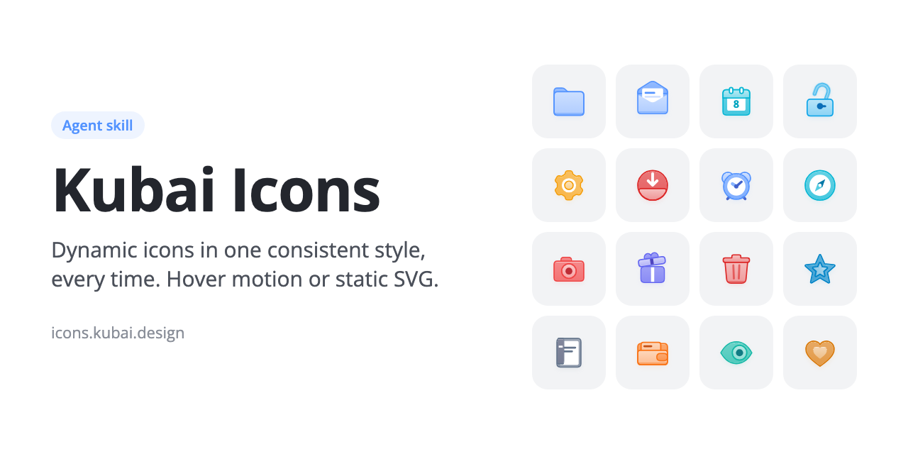
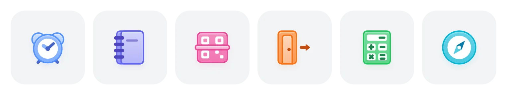
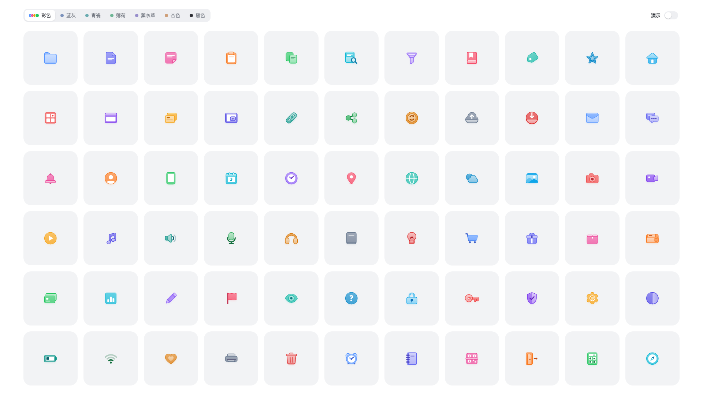

<p align="center">
  
</p>

<p align="center">
  Layered like a folder, outlined outside the fill, coloured from a single accent,
  and moving the way the object itself would when you hover, or exported as static SVG.
</p>

<p align="center">
  <a href="https://icons.kubai.design/icons/">Browse icons</a> ·
  <a href="https://icons.kubai.design/docs/">Docs</a> ·
  <a href="#use-the-icons">Use the icons</a> ·
  <a href="#install-the-skill">Install the skill</a> ·
  <a href="PROMPT.md">Rules</a>
</p>

<p align="center">
  
</p>

## Two things in one repository

- **An open-source icon library.** 2,613 icons (757 objects, plus versions with badges and slashed "off" versions) for React, Vue, plain JavaScript, web components and static SVG. MIT licensed.
- **An agent skill.** The rules, engine and self-check that drew every one of those icons, ready to draw the ones your product is missing in the same hand. Works with Claude Code, Codex and other coding agents.

## Use the icons

| Package | For |
| --- | --- |
| [`kubai-icons-react`](packages/react) | React 18+ and Next.js, server rendering included |
| [`kubai-icons-vue`](packages/vue) | Vue 3 and Nuxt |
| [`kubai-icons`](packages/core) | Any page: a framework-free API and the `<kubai-icon>` web component |
| [`kubai-icons-static`](packages/static) | Standalone SVG files for ``, design tools, native apps and CDNs |

```bash
npm i kubai-icons-react
```

```tsx
import { Folder, CalendarCheck } from "kubai-icons-react";

<Folder />                                            {/* 24px, follows the text colour */}
<CalendarCheck size={32} color="#22C55E" />           {/* any CSS colour */}
<CalendarCheck variant="soft" badgeColor="semantic" /> {/* soft look, green badge */}

<button data-kubai-trigger>
  <Folder size={18} trigger="parent" /> Open          {/* plays when the button is hovered */}
</button>
```

No build step? One script tag loads any icon on demand:

```html
<script type="module" src="https://cdn.jsdelivr.net/npm/kubai-icons@0/dist/element.js"></script>
<kubai-icon name="folder-plus" size="32" color="#6366F1"></kubai-icon>
```

- **Moves like the object.** Every icon has a rest pose and a hover pose, interpolated in 460ms. Hover, focus, a tap, a parent element or your own state can play it.
- **One accent, every colour.** Gradients, outlines, marks and shadows derive from one colour through CSS, so icons follow `currentColor` and recolour without script. Badges stay black and white, or take semantic colours.
- **Pay for what you use.** One side-effect-free ES module per icon, pre-rendered markup, server rendering, and a tiny runtime that only runs while an icon moves.
- **Searchable.** Every icon has a name, a category and tags. Search them on the [website](https://icons.kubai.design/icons/), which also copies code and exports SVG or PNG in any colour.

Guides for every package are in the [documentation](https://icons.kubai.design/docs/).

### Working on the library

Needs Node.js 20 or later; the contact sheets also need Chrome.

```bash
npm install
npm run build        # every package, from icons/ and badges/
npm run validate     # names, metadata and markup of every icon
npm test
node tools/check.mjs --only folder,mail --with download   # contact sheets in check-out/lib
npm run site:dev     # the website
```

Each icon is one module in [`icons/`](icons); [`docs/authoring.md`](docs/authoring.md) explains the format.

## The skill

Kubai Icons is also a skill for coding agents. It is a folder of instructions and scripts, so any agent that can read files and run commands can use it, including Claude Code and Codex. We recommend Claude, which it was developed and tested with. Give it a feature list or a product's code, and it draws icons that sit next to the 66 in this repository as if the same designer had made them, either with hover motion or as static SVG files. The repository ships everything that makes that repeatable, so the model only has to decide what the icon is and draw its shapes:

| Part | What it does for the model |
| --- | --- |
| [`PROMPT.md`](PROMPT.md) | The rules, each one a hard requirement: canvas and keylines, layers, corners and outlines, light, colour, marks and motion. |
| [`src/engine.js`](src/engine.js) | Colour derivation, outside outlines, gradients, shadows, interpolation and palettes are already built. New icons reuse them instead of reinventing them. |
| [`src/icons.js`](src/icons.js) | 66 worked examples. Each new icon starts from the closest one in structure. |
| [`scripts/check.mjs`](scripts/check.mjs) | A headless self-check: rest, hover, every moment in between, 24px, 28px and every palette. The model looks at the screenshots and fixes the icon until the checklist passes. |

## Drawn by the skill

<p align="center">
  
</p>

These six icons were drawn by a fresh Claude session that had nothing but `SKILL.md` and `PROMPT.md`: an alarm clock, a notebook, a QR scanner, an exit door, a calculator and a compass. Each round of these blind tests closes the gaps it finds in the rules, so the next set comes out closer to the rest.

## Install the skill

### Let your agent install it

Copy this into your agent and send it:

```text
Install the Kubai Icons skill for me:
clone https://github.com/kubai087/kubai-icons into your skills folder as kubai-icons
(~/.claude/skills in Claude Code, ~/.agents/skills in Codex;
if it's already there, pull the latest version instead),
make sure SKILL.md exists in that folder, and tell me when it's ready.
```

Then restart your agent, and the skill is ready to use. An agent without skill support can read `SKILL.md` from the cloned folder and follow it.

### Or install it yourself

Download `kubai-icons-v*.zip` from the [latest release](https://github.com/kubai087/kubai-icons/releases/latest) and unzip it into your skills folder. For Claude Code:

```bash
unzip kubai-icons-v1.0.0.zip -d ~/.claude/skills/
```

Or clone the repository there:

```bash
git clone https://github.com/kubai087/kubai-icons.git ~/.claude/skills/kubai-icons
```

Either way, the agent picks the skill up the next time it starts. In Codex, use `~/.agents/skills` instead.

Publishing to a skill marketplace that asks for a version and display names in `SKILL.md`? Upload `kubai-icons-v*-platform.zip` from the same release; it carries those fields at the top of the frontmatter.

### Recommended model

The skill asks for careful geometry, layering across animation frames, and several rounds of looking at its own screenshots, so use a capable model that can read images. It was developed and blind-tested with **Claude Opus 5.5**, which we recommend. Other models, such as GPT in Codex, can use the same skill. In Claude Code, start with:

```bash
claude --model claude-opus-5-5
```

### Ask for icons

Describe what you need in plain words. The skill triggers on requests about icons, so you don't need to name it.

- "Read this repository and draw dynamic icons for its main features."
- "Add a scissors icon and a map icon to this set."
- "We need an icon for Export that matches the others."

### What happens next

1. The agent reads `PROMPT.md`, then writes one line per feature: an everyday object and what it does on hover ("a folder opens", "a lock springs open").
2. It draws each icon after the closest existing one, reusing the engine.
3. It runs the self-check with a few existing icons beside the new ones, compares sizes, outlines, layers and colours, and repeats until every item on the checklist passes.
4. It adds the icons to the gallery and updates the counts.

To start a new set for your own product, the skill copies the engine, gallery and self-check into your project and works there.

## Dynamic or static

Tell your agent which one you need, or it will ask.

| | Dynamic (default) | Static |
| --- | --- | --- |
| What you get | SVG + JS that changes shape on hover, run by the engine | Self-contained `.svg` files, one per icon, no script or stylesheet |
| Where it fits | Web pages and any interface that runs JavaScript | Design tools, native apps, documents, `` tags |
| Motion | Two keyframes per part, rest and hover | None; the rest pose or the end of the hover |

Ask for "static SVG files" or "icons I can drop into Figma", and the skill draws the icons the same way, then exports them. You can also export any icon in this repository yourself:

```bash
node scripts/export.mjs --only 文件夹,日历 --palette 薄荷 --out icons/
```

| Option | What it does |
| --- | --- |
| `--palette` | 彩色 (default), 蓝灰, 青瓷, 薄荷, 薰衣草, 杏色 or 黑色. |
| `--accent #hex` | Paints every icon in one accent colour. |
| `--state hover` | Exports the end of the hover instead of the rest pose. |
| `--size 96` | Width and height in pixels. |
| `--pad 2.5` | Room around the canvas, in icon units, so the shadow isn't cut off. |
| `--out dir` | Where the files go; `export/` by default. |

## How an icon is built

Every icon is a back piece, optional white content and a front piece, like a folder holding a sheet of paper. Outlines sit outside the fill, so shapes keep their full size. Every gradient, outline and shadow is derived from one accent colour, so a single value repaints the whole icon. Each part has exactly two keyframes, rest and hover, and the motion is something the object itself does: the folder opens, the envelope unseals, the calendar turns to the next day.

<p align="center">
  
</p>

Seven palettes come with the set: one colour per icon, five clear tones built from a single base colour (blue-grey, celadon, mint, lavender, apricot), and black. Changing palette animates the colours too.

## Live gallery

<p align="center">
  <a href="https://icons.kubai.design/"></a>
</p>

[icons.kubai.design](https://icons.kubai.design/) shows the whole library: search it, change colours, and hover any icon to see it move. The skill's own gallery, pictured above with its palette and demo switches, opens locally from `index.html`.

## Self-check

Needs Node.js 18 or later and Chrome. Everything runs headless; no window opens.

```bash
node scripts/check.mjs --only 剪刀,地图 --with 文件夹,邮件,下载
```

| Option | What it does |
| --- | --- |
| `--only` | Checks only these icons. Without it, the whole set. |
| `--with` | Adds existing icons beside them for comparison. |
| `--accent #F59E0B` | Paints every icon in one accent colour, to check marks on light accents. |
| `--scale 3` | Renders every sheet at 3×, to look for seams. |
| `--out dir` | Writes the screenshots somewhere other than `check-out/`. |

`CHROME` overrides the browser path. The animations in this README come from `node scripts/media.mjs`, which also needs `ffmpeg` and `img2webp`.

## Contributing

There are several ways in:

- **Improve the skill.** Report a rule that left you guessing, run a blind test with a fresh session, or fix a script. Rule changes start from an issue.
- **Add an icon to the library.** Draw it with the skill (or by hand) as a module in `icons/`, check it with `tools/check.mjs`, and open a pull request. Merged icons are credited to you on the website.
- **Request an icon.** Open an [icon request](https://github.com/kubai087/kubai-icons/issues/new?template=icon-request.yml) with the object and what it should do on hover.
- **Add an example to the skill's gallery.** Design an icon with the skill and open a pull request. Once merged, it joins the gallery, credited to you when someone hovers it.

[CONTRIBUTING.md](CONTRIBUTING.md) has the rules for both. Please read the [code of conduct](CODE_OF_CONDUCT.md) too; security issues go through [SECURITY.md](SECURITY.md).

## License

This repository holds three things under three licences; [LICENSING.md](LICENSING.md) lists which file is which.

**The icons are open source under the [MIT License](LICENSE-ICONS):** every icon in `icons/` and `badges/` and the four packages. Use, change and redistribute them in any project, commercial or not.

**The website is [all rights reserved](LICENSE-SITE):** `site/`, `tools/`, `tests/`, `docs/` and the design of icons.kubai.design. You may read the source and run it to prepare a contribution, but not copy or host it.

**The skill stays under the [Kubai Icons License](LICENSE),** which is source-available rather than open source. In short:

- **Your icons are yours.** Icons you make with the skill belong to you, for any use including commercial, with no credit required.
- **Ship the engine with them.** You may copy the engine, the gallery, the example icons and the self-check into your own icon set's project, change them, and ship that project, as long as the copyright notice at the top of each file stays.
- **Use and share the skill freely.** You may run it for any work, change it for your own use, and share exact, unmodified copies for free.
- **Don't republish it as something else.** Don't distribute a modified or translated version of the rules (`PROMPT.md`, `SKILL.md`), sell the skill, remove its notices, or present it under another name or as your own work.

The Kubai and Lumno names and logos are not licensed for reuse. The construction comes from the bookmark folder icon in [Lumno](https://github.com/kubai087/lumno-extension).
