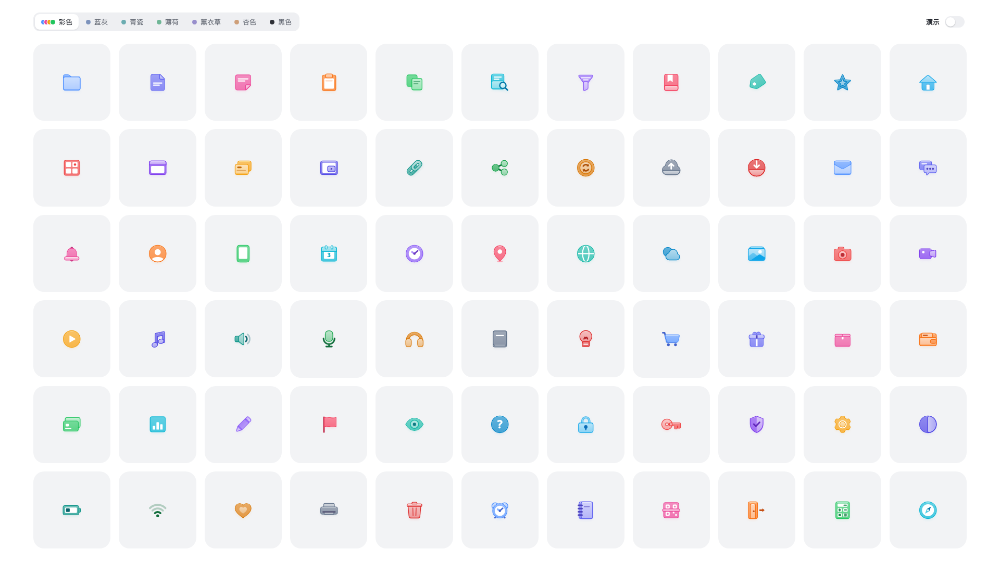
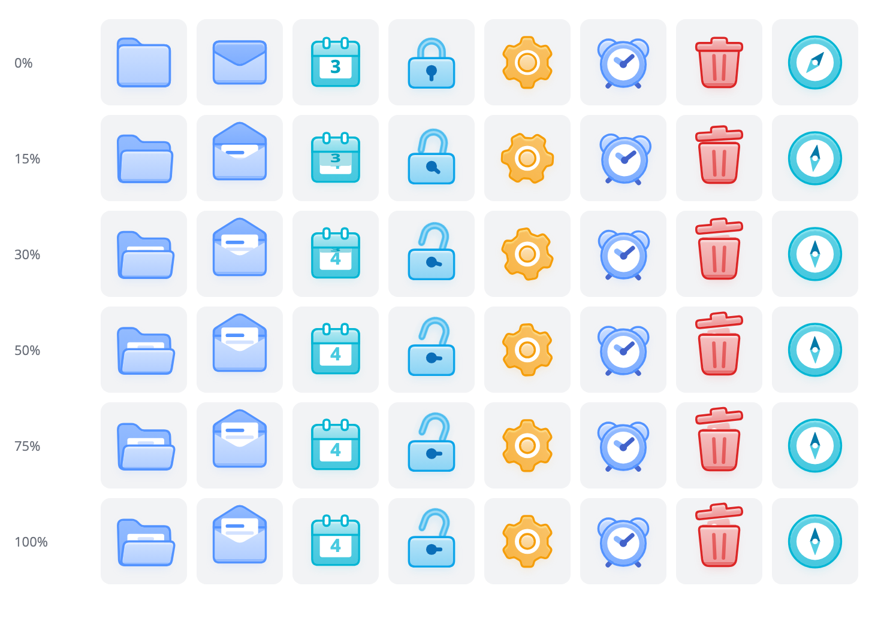
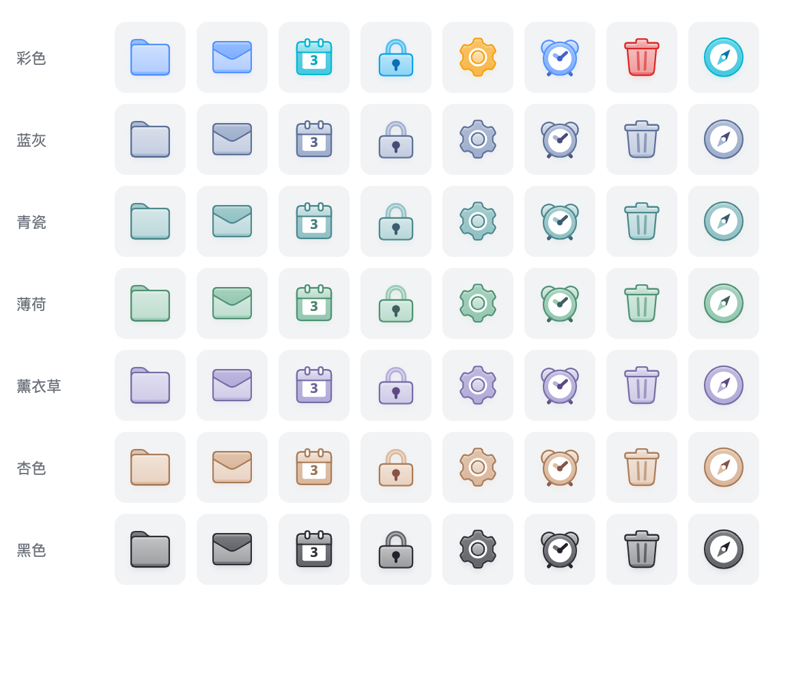

<h1 align="center">Kubai Icons</h1>

<p align="center">
  66 个悬停时会形变的功能图标，构造方法来自
  <a href="https://github.com/kubai087/lumno-extension">Lumno</a> 的书签文件夹图标。
  <br />
  整个仓库同时也是一个 Claude skill，可以按同样的风格画新图标。
</p>

<p align="center">
  <a href="PROMPT.md">设计规则</a> ·
  <a href="SKILL.md">Skill 说明</a>
  <br />
  <a href="README.zh-CN.md">简体中文</a> |
  <a href="README.md">English</a>
</p>

<p align="center">
  
</p>

## 包含什么

| 路径 | 内容 |
| --- | --- |
| `index.html` | 展示页：全部图标，可以切换色板、开关演示。直接用浏览器打开。 |
| `src/engine.js` | 颜色推导、动效、几何工具、渐变与滤镜，以及挂载、绘制、动画的运行时。 |
| `src/icons.js` | 图标定义。每个图标由 `svg(u)`、`target(hover, state)`、`draw(p, E)` 三部分组成。 |
| `src/app.js` | 展示页的网格和控件。`ORDER` 决定展示哪些图标、按什么顺序排。 |
| `scripts/check.mjs` | 自检脚本。在无头 Chrome 里截出静止、悬停、悬停过程、24px、28px 和所有色板，并读出脚本报错。 |
| `PROMPT.md` | 每个图标都要遵守的设计规则。 |
| `SKILL.md` | 作为 Claude skill 使用时的说明和流程。 |
| `history/` | 定型之前的三个版本，留作过程记录。 |

## 图标是怎么构造的

每个图标由后片、可选的白色内容和前片组成，就像文件夹里夹着一张纸。描边放在填充外侧，形状不会被挤小。所有渐变、描边和投影都从一个主色推导。每个部件只有静止和悬停两组关键帧，动作是物体本身会做的事：文件夹打开、信封拆开、日历翻到下一天。



自带七个色板：每个图标一个颜色的彩色、由单一基色推导出的五种清透色，以及黑色。



完整规则见 [PROMPT.md](PROMPT.md)：画布与 keyline、分层、圆角与描边、光影、颜色、标记、动效，以及每个图标都要通过的自检清单。

## 作为 Claude skill 使用

```bash
git clone https://github.com/kubai087/kubai-icons.git ~/.claude/skills/kubai-icons
```

然后直接让 Claude 画图标，例如"往这套图标里加一个剪刀"或"给这个应用做一套动态图标"。skill 会先读 `PROMPT.md`，参照结构最接近的现有图标来写，再反复运行自检直到通过。流程见 [SKILL.md](SKILL.md)。

## 自检

需要 Node.js 18 以上和 Chrome。全程无头运行，不会打开任何窗口。

```bash
node scripts/check.mjs --only 剪刀,地图 --with 文件夹,邮件,下载
```

| 参数 | 作用 |
| --- | --- |
| `--only` | 只检查这些图标。不加就检查整套。 |
| `--with` | 加几个现有图标放在旁边对比。 |
| `--accent #F59E0B` | 把所有图标换成同一个主色，检查浅主色上的标记。 |
| `--scale 3` | 按 3 倍渲染所有截图，用来查细缝。 |
| `--out dir` | 截图输出到 `check-out/` 以外的目录。 |

浏览器路径可以用环境变量 `CHROME` 覆盖。

## 参与贡献

欢迎报告问题、反馈规则和提交修复。请先读 [CONTRIBUTING.md](CONTRIBUTING.md) 和[行为准则](CODE_OF_CONDUCT.md)；安全问题请按 [SECURITY.md](SECURITY.md) 私下报告。

## 许可

本仓库采用 [Kubai Icons License](LICENSE)，属于源码可见，不是开源许可。简单来说：

- **你画的图标归你。** 用这个 skill 做出来的图标归你所有，可以用于包括商业在内的任何用途，不需要署名。
- **可以带着引擎发布。** 引擎、展示页、范例图标和自检脚本可以复制进你自己那套图标的项目里，按需修改后发布，只要保留每个文件开头的版权声明。
- **可以自由使用和转发 skill。** 可以用它做任何项目，可以为自己的使用而修改，也可以免费转发完全未修改的副本。
- **不能改头换面再发布。** 不能发布修改或翻译过的规则（`PROMPT.md`、`SKILL.md`），不能出售这个 skill，不能删除版权声明，也不能换个名字或声称是自己的作品。

Kubai 和 Lumno 的名称与标志不在授权范围内。
